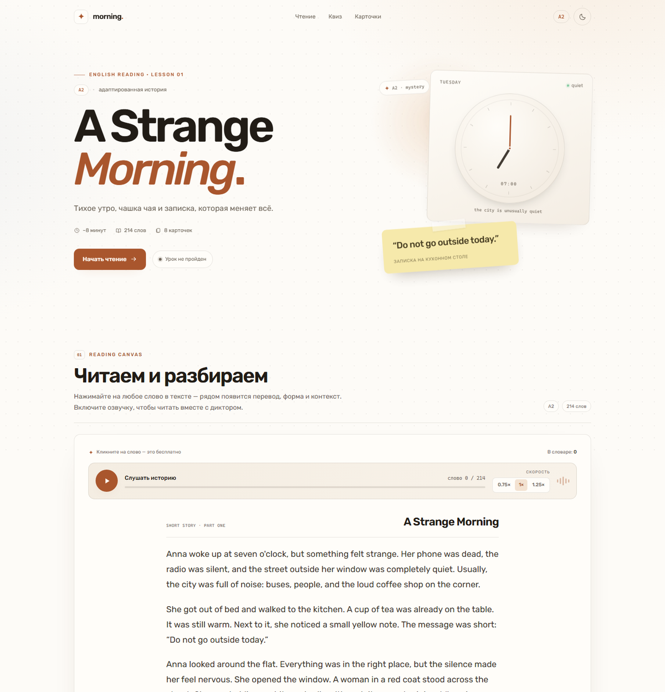
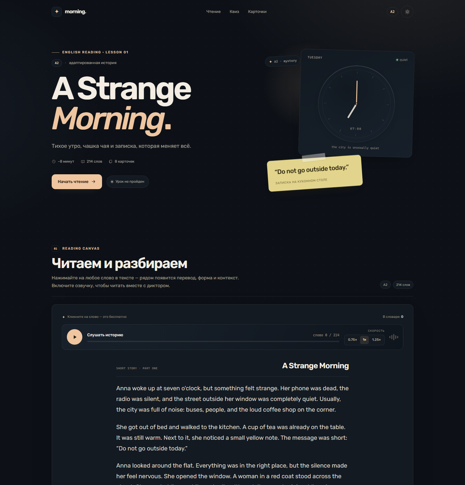

# A Strange Morning — интерактивный урок английского

Одностраничный урок для уровня A2: адаптированная история, контекстный перевод по клику, озвучка, квиз и карточки для интервального повторения. Сделан на чистом HTML, CSS и JavaScript — без сборки и зависимостей.



<details>
  <summary>Тёмная OLED-тема</summary>

  
</details>

## Что умеет

- **Reading Canvas.** История «A Strange Morning» на 214 слов. Каждое слово кликабельно: открывается поповер с переводом, частью речи, транскрипцией, предложением из текста и пояснением для сложных слов. Слова можно сохранять в личный словарь.
- **Озвучка.** Кнопка «Слушать / Пауза», скорости 0.75×, 1× и 1.25×. Активное слово подсвечивается мягким фоном без изменения размеров шрифта и отступов; `line-height` текста — 1.8. Если браузер не присылает события границ слов, включается плавная оценка прогресса.
- **Квиз.** Пять вопросов с мгновенной проверкой: правильный вариант — зелёный, ошибка — красный, плюс короткое объяснение. Результат сохраняется.
- **Флеш-карточки.** Восемь ключевых слов с переводом, транскрипцией и примером. Кнопки «Забыл» / «Помню», интервалы 1 / 3 / 7 дней. Карточка полностью помещается на экране телефона — без внутреннего скролла.
- **Память.** Прогресс квиза, сохранённые слова и расписание карточек хранятся в `localStorage`. При повторном входе видно, что урок пройден, а карточки возвращаются в нужный день.
- **Две темы.** Тёплая кремовая `#FDFBF7` и OLED-тёмная `#0D1117`, Rubik, скругления 14 px. Выбор темы запоминается; по умолчанию берётся системная.

## Локальный запуск

Открывать `index.html` двойным щелчком нельзя: браузер блокирует `fetch()` для локальных файлов. Нужен простой сервер:

```powershell
cd проект
python -m http.server 8080
```

Откройте `http://localhost:8080`.

Альтернатива с Node.js:

```powershell
npx serve .
```

## Структура

```text
.
├── index.html
├── assets/
│   ├── css/styles.css
│   ├── js/app.js
│   ├── favicon.svg
│   └── img/                 # здесь можно хранить свои изображения
├── data/
│   └── lesson.json          # весь контент урока
├── preview.png              # светлая тема
├── preview-dark.png         # тёмная тема
└── README.md
```

## Как редактировать урок

Весь контент — в `data/lesson.json`.

- `meta` — заголовок, уровень, время, подзаголовок и цитата для обложки.
- `story.paragraphs` — массив абзацев. Текст автоматически разбивается на кликабельные слова.
- `dictionary` — перевод слов. Ключ — слово в нижнем регистре. Значение может быть строкой с переводом или объектом:
  ```json
  "strange": {
    "translation": "странный, необычный",
    "ipa": "/streɪndʒ/",
    "pos": "прилагательное",
    "base": "strange",
    "note": "Пояснение, которое появится в поповере."
  }
  ```
  Для каждой словоформы из текста нужен свой ключ (например, `noticed`, а не только `notice`).
- `quiz` — массив вопросов: `question`, `options`, `correct` (индекс с нуля), `explanation`.
- `flashcards` — массив карточек: `word`, `translation`, `ipa`, `pos`, `example`, `exampleRu`.

Если слово не найдено в словаре, поповер всё равно откроется и покажет предложение из текста; перевод можно добавить позже.

## Прогресс и сброс

- Ключ прогресса: `morning-lesson-v1`.
- Ключ темы: `morning-theme`.
- Сбросить весь прогресс можно кнопкой **«Сбросить прогресс»** в футере. Она очищает ответы квиза, словарь и расписание карточек, но не удаляет сам урок.
- Кнопка **«Пройти заново»** в результате квиза сбрасывает только квиз.

## Озвучка

Используется Web Speech API (`speechSynthesis`) с английским голосом `en-US`. Доступные голоса зависят от браузера и операционной системы. В Chrome и Edge на Windows/macOS обычно всё работает сразу; в некоторых средах без голосовых пакетов кнопка озвучки отключится или покажет сообщение об ошибке. Это не мешает читать текст, открывать переводы и проходить урок.

Кнопки скорости меняют темп, не меняя разметку текста. При паузе и возобновлении чтение продолжается с текущего слова.

## Деплой

Проект статический: подойдут GitHub Pages, Cloudflare Pages, Netlify или любой обычный веб-сервер.

- **GitHub Pages:** загрузите папку в репозиторий, включите Pages для нужной ветки и корневой папки. Файл `.nojekyll` уже добавлен.
- **Cloudflare Pages:** подключите репозиторий, выберите **Framework preset: None**, оставьте Build command пустым, а Build output directory укажите `/`.

Локально и на хостинге важно, чтобы `data/lesson.json` был доступен по тому же пути относительно `index.html`.

## Проверено

- 1440 px — светлая и тёмная темы, поповеры, квиз, флеш-карточки.
- 390 / 360 / 320 px — нет горизонтального скролла, карточки и их обратные стороны полностью помещаются без внутреннего скролла.
- Перезагрузка страницы сохраняет тему, результат квиза и сохранённые слова.
